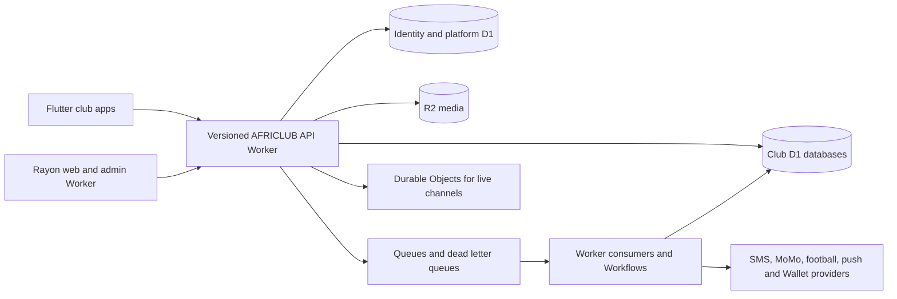

# AFRICLUB Supabase exit to Cloudflare — migration plan

Date: 24 September 2026. Scope: the shared AFRICLUB backend used by the native club apps and Rayon Sports web/member/admin surfaces. The separate Gikundiro website is not a delivery target. Its public Supabase content currently read by Rayon must nevertheless be copied into the new Cloudflare content service before either Supabase project is discontinued.

This is a design and execution plan, not an assertion that Cloudflare resources exist or that production data has been exported. The recovered checkout has extensive unrelated edits. No database, Worker, or production service was changed in preparing this plan. A read-only live inventory was captured on 24 September 2026; see [stage-0 findings](cloudflare-stage0-live-inventory-2026-09-24.md).

## What the repository currently depends on

The local repository contains 36 Supabase migration files, 18 Edge Function entrypoints and 37 SQL contract files. A text scan finds 157 `CREATE TABLE` declarations, about 337 distinct function names, 38 distinct view names, 332 policy names, and 23 trigger declarations across the migration history. These are **declarations, not live-object counts**: the baseline contains legacy objects and later migrations alter or retire them. The refreshed five-schema live inventory on 25 September records 197 tables, 37 views, 342 application functions, 354 policies and 198 non-internal triggers. It includes the previously missed `africlub_game` schema. Provider-managed `cron` and `net` schemas require separate disposition.

Current dependency families:

| Existing authority | Representative code and replacement obligation |
| --- | --- |
| Supabase Auth and JWT | Anonymous sessions, phone/WhatsApp OTP, phone changes, profile restore, custom access-token claims, admin roles and sign-out. Replace identity, session rotation/revocation, role checks and migration of user IDs; Cloudflare Turnstile alone is not user authentication. |
| PostgreSQL and PostgREST | Public/football schemas, RLS, grants, `SECURITY DEFINER` RPCs, views and triggers. Replace with a versioned Worker API, explicit authorization, SQLite schema and tested command handlers. No direct client SQL or generic public table API. |
| Financial and entitlement transactions | MoMo evidence/reconciliation, payment intents, membership activation, shop orders/stock, ticket issuance/admission, contributions, FET wallet and Predict settlement. Preserve one authoritative commit boundary, idempotency, immutable evidence and audit trail. PostgreSQL row/advisory locks cannot be copied mechanically into D1. |
| Edge Functions and scheduled SQL | Football/live-score sync, SMS parsing, notifications, images, ticket passes, settlement and account deletion. Port to Workers, Queues, Workflows and scheduled handlers after mapping each function's inputs, secrets, side effects and retry contract. |
| Realtime | Supabase Postgres-change channels for matches/fixtures. Replace with server-authorized Durable Object WebSocket channels, or polling where realtime is unnecessary. Topic names alone do not authorize subscriptions. |
| Media | Two public buckets exist: `product-images` holds eight objects and `africlub-product-images` is empty as of the inventory. Copy originals to R2, preserve keys, checksums, visibility and usage-rights metadata; use the existing Cloudflare Images binding where transformations are useful. |
| Clients | Native `SupabaseClientFactory`, auth/network/data feature packages; Rayon Next.js server/browser/admin clients; currently deployed public Gikundiro-source adapter. Move behind typed, versioned API clients before removing Supabase configuration. |

The current Rayon web app already runs as an OpenNext Cloudflare Worker (`apps/rayon_sports/web/wrangler.jsonc`) with an assets, KV cache and Images binding. That is **frontend hosting**, not backend migration. The current backend remains Supabase. The five app directories in this checkout are Rayon Sports, Vital’O, Nkana, AS Vita and Costa do Sol. The live club registry has 96 rows, but only Rayon Sports is both onboarded and active. Other app release targets still need separate readiness confirmation.

The stage-0 inventory must produce a machine-readable ledger with one row for **every live** table, view, RPC/function, policy, trigger, index, storage bucket/object class, auth identity, scheduled job, Edge Function, secret name and caller. Record owner, data classification, row count/bytes, contract tests, Cloudflare destination and retirement status. The historical SQL declarations above are only a starting search index.

All 18 Edge Function entrypoints need an explicit disposition:

| Function group | Current entrypoints | Candidate Cloudflare destination |
| --- | --- | --- |
| Public/admin API | `get-platform-config`, `admin-settle-fixture`, `record-operational-health`, `delete-account` | Versioned API/admin Worker; account deletion may need a Workflow for external side effects. |
| Payment and SMS | `sms-ingest`, `parse-momo-sms`, `send-sms` | Verified webhook/API Worker; idempotent Queue consumer and provider adapter. |
| Football and prediction | `football-sync`, `livescore-openai-sync`, `settle-prediction-notifications` | Cron-triggered Workflow/Queue with source provenance, settlement command and reconciliation. |
| Notifications | `admin-send-notification`, `send-notification`, `dispatch-scheduled-notifications` | Admin command, Queue consumers and scheduled dispatcher with delivery receipts. |
| Media | `admin-upload-image`, `generate-admin-image`, `generate-product-image` | Authenticated Worker/Workflow, R2 and exact media-rights metadata. |
| Wallet and admission | `google-wallet-ticket-pass`, `sync-google-wallet-ticket-state` | Worker/Workflow and Queue with signed provider callbacks and ticket-state checks. |

These destinations are design candidates. The live project has 18 deployed Edge Functions and six active cron jobs. Two deployed functions, `game-session-action` and `generate-question-drafts`, are absent from this checkout and need source recovery or behavioral replacement. Two local Wallet functions are not deployed. The live function list, not just the local directory, controls the porting scope.

## Recommended Cloudflare topology

1. **Workers API:** one public/member API with explicit `/v1` contracts, separate privileged admin and provider-webhook entrypoints or service-bound Workers. Every request resolves authenticated user, club, role, resource and operation on the server. Use bindings instead of Cloudflare REST API calls from Workers; keep secrets in Worker secrets/Secrets Store.
2. **D1:** start with a global identity/platform database and one relational database per active club, subject to measured size and load. Keep each club's orders, payment evidence, ledger, membership and ticket state in **the same transactional database**. Use foreign keys, unique idempotency constraints and atomic `batch()` operations. Do not split one financial transaction across D1, Durable Objects or Queues. D1's single-database size and serialized query execution make partitioning and performance tests mandatory. Public catalogue projections can be cached; balance and post-payment reads must use the primary or a D1 session bookmark.
3. **Durable Objects:** use SQLite-backed objects for match/live WebSocket fanout, short-lived rate or coordination state and alarms if needed. They are not an automatic replacement for the current cross-table payment ledger. Only promote them to a financial source of truth if a separate transaction design and reconciliation proof justifies it.
4. **R2 and Images:** object keys plus D1 rights/provenance records; private objects require server authorization and short-lived access, public ones get stable content URLs. Hash every exported source file and verify the destination hash before changing links.
5. **Queues, Workflows, Cron:** queue notifications, ingestion, image work and provider follow-up with stable idempotency keys and dead letter queues. Use Workflows for long multi-step operations and scheduled Workers for periodic discovery/locking. A queue is at-least-once delivery, so the D1 command must deduplicate effects. The provider callback or verified receipt, not queue completion, is payment authority.
6. **Security/operations:** WAF/API Shield and rate limits for public endpoints; Turnstile with server-side validation on abuse-prone browser forms; Cloudflare Access for staff/admin **only if** it fits the staff identity model; structured Workers logs/traces, alerts, audit events and backup export to R2. Keep external MoMo, SMS/WhatsApp, APNs/FCM, Google Wallet and football feeds as integrations, with credentials server-side.

Products reviewed but not selected as primary authorities: Workers KV is useful for cache/config, not money or current membership balances; Hyperdrive is a temporary PostgreSQL bridge only if needed for extraction, not a Supabase-free database; Workers AI/AI Gateway can be evaluated for image or text tasks after functional migration; Vectorize, Stream and Browser Rendering have no demonstrated core-backend requirement in this repository. The existing Worker Static Assets binding continues to serve Rayon web assets, while the new Workers serve the API.

Cloudflare's D1 is SQLite, so PostgreSQL `jsonb`, array, enum, function, trigger, lock, RLS and schema behavior must be translated deliberately. A mechanically converted schema is not an acceptable migration. D1 `batch()` provides atomic sequential statements, but the money-path design must be proven under concurrency and injected failure before approval. Cloudflare's published paid-plan D1 maximum is 10 GB **per database**, and each database processes queries serially; confirm the account plan and measured growth before committing to this topology.

## Ordered execution

| Stage | Work | Exit evidence |
| --- | --- | --- |
| 0. Preserve source and freeze scope | Confirm active clubs, project refs and owners. Obtain full logical PostgreSQL/schema and row exports, auth user/identity mapping, all Storage objects and metadata, scheduled jobs, Edge Function secret-name inventory and current live API contract. Take an independent restorable backup. If the current quota restriction prevents a complete export, stop here and restore export access. | Signed inventory and backup restore drill; row counts/size by table, media object count/bytes/hash, auth count, all scheduled jobs. |
| 1. Prove architecture | Spike one representative club database and four hardest commands: MoMo evidence allocation, paid membership activation, Predict stake/settlement and ticket reservation/issue/redeem. Simulate duplicate callbacks, parallel requests, timeouts, crash after commit and retries. Benchmark D1 size, query cost and throughput against agreed traffic. | Zero duplicate money effects, zero unjustified balance changes, exact audit trail and agreed load/latency targets. Revisit topology if D1 cannot meet them. |
| 2. Build platform | Create isolated dev/staging/prod Workers, D1, R2, Queues, DLQs and secrets through versioned Wrangler/IaC. Define OpenAPI, typed client SDK, schema migrations, error taxonomy, event IDs, tracing, restore procedure and release manifests. | Local and remote staging migrations replay cleanly; no privileged keys in clients; rollback/forward-recovery drill. |
| 3. Replace identity and authorization | Implement phone/WhatsApp OTP delivery via current provider, anonymous-to-verified account linking, rotating sessions, revocation, account deletion and staff RBAC. Preserve Supabase user UUIDs as stable external IDs or provide an explicit one-to-one mapping. Reauthentication on old-app upgrade is safer than trusting old JWTs indefinitely. | Real provider OTP test, cross-club and cross-role denial tests, sign-out/revocation, lost-session recovery, rate-limit and abuse tests. |
| 4. Move public reads and media | Export approved Gikundiro-derived Rayon content, club catalogues, fixtures/news/squad/fanclubs/partners/shop and both live Storage buckets to D1/R2. Replace current direct Gikundiro Supabase reads. Port public pages and native repositories to the versioned API behind feature switches. | Exact published-row and media-hash parity, attribution/rights parity, deep links, empty/error/offline states and all active-club scoping. |
| 5. Port transactional domains | Move member profile/membership, contributions, MoMo parser and reconciliation, shop, tickets/admission, FET/Predict and admin commands in dependency order. Translate every live RPC, policy and trigger to explicit server behavior; keep append-only ledgers and outbox events in the same commit as the business mutation. | Existing SQL contract intent restated as Worker/D1 tests; negative authorization, duplicate/replay, concurrent stock/seat/balance and settlement tests all pass. |
| 6. Jobs, realtime and integrations | Port 18 Edge Function entrypoints and live scheduled jobs after determining which remain active. Add queue/DLQ replay tooling, provider-signature verification, football source provenance, push and Wallet support, WebSocket authorization and recovery. | End-to-end provider sandbox/live evidence, queue retry/DLQ drills, client reconnect, monitoring and operational runbooks. |
| 7. Shadow and cut over | Backfill in versioned batches. Compare source/destination counts and deterministic row hashes. Shadow **reads/calculations**, not independent financial writes. At a planned write freeze, drain queues/callbacks, take final delta, reconcile every open payment/prediction/ticket, switch API clients and release a minimum-version gate for old app builds. | Exact money/entitlement/ticket parity, no unprocessed callbacks, successful physical-device and web journeys, deployment revision readback and owner acceptance. |
| 8. Retire Supabase | Monitor the Cloudflare-only release through a defined observation window. Rotate/revoke Supabase keys, remove anon URLs from all app flavors and web envs, disable old functions/jobs, and then decommission both AFRICLUB and any Gikundiro source dependency after retention/export obligations are met. | Dependency scan finds no runtime Supabase calls; DNS/runtime probes, backup restore, audit record and cost check all pass. |

## Cutover rules

- Keep **one writer** for money, entitlements, FET and ticket issuance at every point. Dual-writing financial commands into two independent databases is not a rollback strategy.
- Preserve original IDs where possible; when impossible, use a versioned mapping table with source project, source table, source ID and target ID. Never merge records on names alone.
- A simple traffic flip back to Supabase is safe only **before** the first Cloudflare financial write. After that, recovery is a forward migration/reconciliation exercise to avoid double charging or duplicated tickets.
- The migration is complete only when no released client, admin route, webhook, scheduled job, media URL or public-source adapter needs Supabase at runtime. A successful Worker deployment or HTTP 200 does not prove this.

## Known decisions and blockers

- **Export access:** read-only Management API queries work and yielded a live inventory, including 178 auth users and 229 MB database size. A schema-only PostgreSQL archive for `public`, `football`, `auth` and `storage` was captured and read back. On 25 September, a full database archive excluding only `cron.job_run_details` data completed and passed archive readback; that cron history was exported separately in 40 verified segments. The archive and all 40 segments passed a restore drill in an isolated PostgreSQL 17.6 container with sampled row-count readback. The pair is still not one transactionally consistent final snapshot. Both authenticated and public AFRICLUB Storage object downloads return HTTP 402 with `exceed_storage_size_quota`; the provider response says the owner must upgrade the plan or remove the spend cap. Its eight originals have not been exported. A final consistent backup and complete object export remain mandatory before cutover or shutdown.
- **Rayon public source:** approved public rows used by Rayon were captured from the separate Gikundiro source. All 2,628 captured rows and 11 media metadata records were imported into isolated remote Cloudflare D1 staging with exact export parity. Eleven originals were uploaded to private R2 staging and passed byte-hash readback. A deployed staging Worker serves nine fixed read-only public routes; it suppresses uncleared partner images and returns 503 after 24 hours without a fresh snapshot. The Rayon web adapter can opt into the staging API and passed a live smoke test, but no production client has switched. This does not migrate Gikundiro member or payment transactions, and it does not provide a governed content-authoring and refresh path.
- **Cloudflare capacity and locality:** account plan, D1 sizes/throughput, R2 size, data-residency requirements and worker spend are unknown. Measure before purchase or final partition design.
- **Deployed function recovery:** all 18 live function bodies are archived as SHA-256-verified ESZIP bundles. Their first-party modules were extracted privately, including the two entrypoints absent from the checkout. All 16 overlapping entrypoints have differing raw hashes, which require behavior-level comparison before replacement. No function has yet been ported. The CLI download path fails on the remote project's SMS Auth hook secret configuration; the read-only ESZIP parser succeeded.
- **Auth ownership:** Cloudflare Access can protect staff surfaces, but supporter phone identity still needs a dedicated application auth service and an SMS/WhatsApp delivery provider. Decide that contract before porting clients.
- **Financial proof:** D1 batch atomicity is promising, but it does not reproduce PostgreSQL advisory/row locks, `SECURITY DEFINER` code or RLS. The stage-1 transaction spike is a mandatory go/no-go gate.
- **Active clubs:** only Rayon Sports is both onboarded and active in the live registry. Costa do Sol has a production-flavor app directory; confirm the release inventory for all other app flavors before creating their tenant databases.

## Official Cloudflare references checked 24 September 2026

- [D1 limits](https://developers.cloudflare.com/d1/platform/limits/), [D1 batch behavior](https://developers.cloudflare.com/d1/worker-api/d1-database/), [D1 migrations](https://developers.cloudflare.com/d1/reference/migrations/), [D1 Time Travel](https://developers.cloudflare.com/d1/reference/time-travel/) and [read replication consistency](https://developers.cloudflare.com/d1/best-practices/read-replication/).
- [SQLite-backed Durable Object transactions](https://developers.cloudflare.com/durable-objects/api/sqlite-storage-api/) and [WebSocket hibernation](https://developers.cloudflare.com/durable-objects/best-practices/websockets/).
- [Queue delivery guarantees](https://developers.cloudflare.com/queues/reference/delivery-guarantees/), [dead letter queues](https://developers.cloudflare.com/queues/configuration/dead-letter-queues/), [Workflow retry rules](https://developers.cloudflare.com/workflows/build/rules-of-workflows/) and [Cron Triggers](https://developers.cloudflare.com/workers/configuration/cron-triggers/).
- [R2 objects and uploads](https://developers.cloudflare.com/r2/objects/upload-objects/), [Workers secrets](https://developers.cloudflare.com/workers/configuration/secrets/), [Turnstile server verification](https://developers.cloudflare.com/turnstile/get-started/server-side-validation/) and [Workers limits](https://developers.cloudflare.com/workers/platform/limits/).
